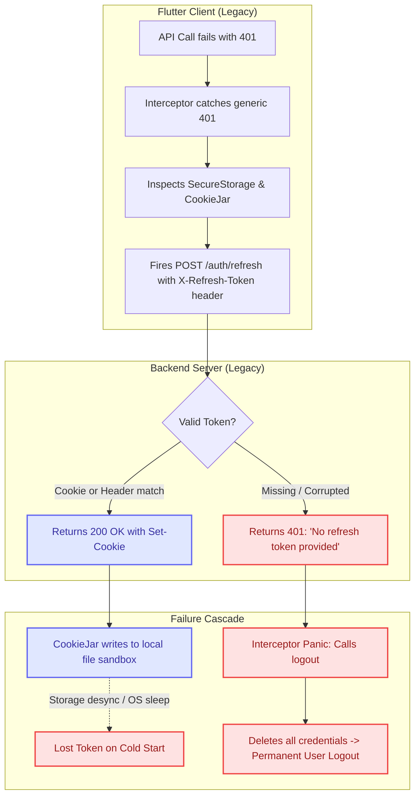
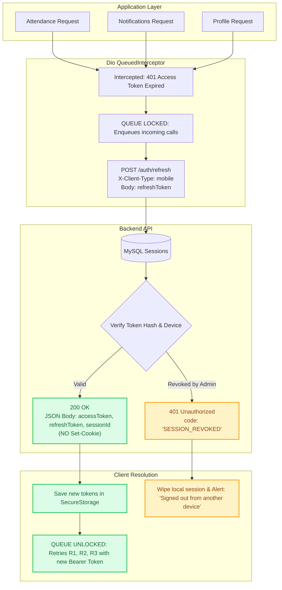

# Mobile Authentication Architecture Modernization
## Purpose of Change, Before vs. After Analysis, and Technical Blueprint

> **Document Version:** 1.0.0  
> **Target Repository:** `MANO-HRM-App` (Flutter Mobile Application)  
> **Backend Integration:** `MANO-HRM-Web` (`/backend/src/modules/auth`)  
> **Date:** October 2026  

---

## 1. Executive Summary & Purpose of Change

### Why Are We Making This Change?
The mobile application currently relies on a hybrid session model combining HTTP cookies (`PersistCookieJar`), a custom header (`X-Refresh-Token`), and local storage (`FlutterSecureStorage`). 

While this model functioned as a bridge, it introduced distinct operational liabilities on mobile operating systems:

1. **Cookie Inconsistency on Mobile Devices**: Unlike web browsers which automatically govern `httpOnly` cookie jars across tab reloads, mobile operating systems (iOS Keychain, Android Keystore, background task managers, OS battery optimizations) frequently encounter synchronization lags across network handoffs (e.g., switching from Office Wi-Fi to Cellular 5G).
2. **Lack of Per-Device Identity**: Previous mobile requests lacked persistent device identifiers. When a user logged into their phone, the backend had difficulty distinguishing that session from their web browser session, risking cross-device session collisions or unexpected session invalidations.
3. **Fragile Error Parsing**: The mobile client previously relied on generic HTTP status codes (`401`, `403`) and English string matching (e.g., `"No refresh token provided"`). This could cause the app to mistakenly wipe user credentials when a transient or non-fatal error occurred.
4. **Race Conditions During Parallel Requests**: When an access token expires (15-minute lifespan), multiple simultaneous dashboard requests (attendance records, notifications, profile, shift policies) could fire duplicate refresh requests at the server simultaneously.

### The Objective
Transition the Flutter mobile app to a **pure, explicit JSON-body token transport** coupled with **hardware device fingerprinting** and **machine-readable error code handling**. 

This transition operates under the **"Expand & Contract"** pattern:
- The backend has already expanded to accept this new format without disrupting existing web or legacy clients.
- Upgrading the Flutter app completes the client-side modernization.

---

## 2. Before vs. After Architectural Comparison

| Architectural Aspect | Previous Architecture ("Before") | New Modernized Architecture ("After") |
| :--- | :--- | :--- |
| **Token Transport** | Hybrid: Cookies (`Set-Cookie`) + custom `x-refresh-token` header + body fallback. | **Strict JSON Body**: Tokens are explicitly passed in JSON request/response bodies. No cookies used for mobile. |
| **Request Headers** | Standard headers with sporadic `x-refresh-token` and `Authorization: Bearer`. | **Contracted Mobile Headers**: Every request explicitly includes `X-Client-Type: mobile`, `X-App-Version`, `X-Device-Id`, and `X-Device-Name`. |
| **Device Identity & Deduplication** | Undefined/User-Agent based. Server treated mobile sessions generically. | **Hardware Fingerprinted**: Device ID & Model attached to each session row. Allows remote individual device revocation from Web UI. |
| **Token Refresh Mechanism** | Custom `_synchronizedRefreshToken` with in-flight Future lock in `AuthService`. | **Dio `QueuedInterceptor`**: Automatically queues and holds parallel outgoing HTTP requests while a single refresh runs. |
| **Error Handling** | Blanket checks on `statusCode == 401` and heuristic string inspection. | **Machine-Readable Contract (`AUTH_ERROR_CODES`)**: Deterministic handling for `SESSION_REVOKED`, `TOKEN_EXPIRED`, `ACCOUNT_INACTIVE`, etc. |
| **Local Storage Source of Truth** | Dual-split between `FlutterSecureStorage` and `PersistCookieJar` sandbox files. | **Unified Secure Vault**: `FlutterSecureStorage` holds `accessToken`, `refreshToken`, `sessionId`, and persistent `deviceId`. |
| **Session Longevity** | Vulnerable to false-positive storage wipeouts on cold start or network drops. | **Resilient Sliding Window**: Seamless 30-day sliding session with zero risk of premature logout on offline/network errors. |

---

## 3. Visual Flow Comparison

### A. "Before" Flow: Vulnerabilities & Failure Cascade



---

### B. "After" Flow: Deterministic Queued Interceptor & Explicit Transport



---

## 4. What the New Implementation Does (Feature Breakdown)

### 1. Device Identification & Telemetry Layer
* **Automatic Device Header Injection**: Every outgoing request attaches:
  * `X-Client-Type: mobile`
  * `X-App-Version`: Sourced dynamically from `package_info_plus` (e.g. `1.1.0`).
  * `X-Device-Id`: Hardware-backed unique identifier (e.g., Android DRM ID / iOS `identifierForVendor`) or securely generated UUID persisted in `FlutterSecureStorage`.
  * `X-Device-Name`: User-friendly hardware model (e.g., `"Pixel 8 Pro"`, `"iPhone 15"`).
* **Benefit**: The web application's Active Sessions manager displays the exact phone model, IP, and last active time. If the user logs out on their laptop, their phone session is completely unaffected.

### 2. Explicit JSON Body Endpoints
* **Login (`POST /auth/login`)**:
  * Body: `{"user_input": "...", "user_password": "...", "rememberMe": true}`
  * Response: Extracts `accessToken`, `refreshToken`, and `sessionId` from the JSON body.
* **Refresh (`POST /auth/refresh`)**:
  * Body: `{"refreshToken": "<stored_token>"}`
  * Headers: `X-Client-Type: mobile`
  * Response: Saves the refreshed `accessToken` and slides the `refreshToken` forward 30 days.
* **Logout (`POST /auth/logout`)**:
  * Body: `{"refreshToken": "<stored_token>"}`
  * Server revokes only this physical device's session row in the database.

### 3. Machine-Readable Error Contract
The app inspects `error.response.data['code']` instead of raw HTTP statuses or English text strings:

| Backend Error Code | Status | What It Means | Client Action |
| :--- | :---: | :--- | :--- |
| `SESSION_REVOKED` | 401 | Remote revocation from Web Settings or password change | Clear storage $\rightarrow$ Show toast: *"Your session was ended from another device."* $\rightarrow$ Route to Login. |
| `SESSION_EXPIRED` | 401 | Inactive for > 30 days | Clear storage $\rightarrow$ Show toast: *"Session expired. Please log in again."* $\rightarrow$ Route to Login. |
| `TOKEN_EXPIRED` | 401 | 15-minute Access Token expired | Silent background refresh via `QueuedInterceptor`. |
| `ACCOUNT_INACTIVE` | 403 | Employee deactivated by HR | Prompt user with alert dialog: *"Your account is inactive. Please contact HR."* |
| `ORG_INACTIVE` | 403 | Organization subscription suspended | Prompt user with alert dialog: *"Organization account is suspended."* |
| `NO_REFRESH_TOKEN` | 401 | Refresh called with empty token | Abort and prompt user to login without corrupting state. |

### 4. Seamless Migration for Existing Users
Existing users running earlier versions will have active sessions stored in `FlutterSecureStorage` or `PersistCookieJar`:
* On application launch, a migration layer checks for an existing session token.
* If found, it seeds the new `AuthStorageService` with the refresh token and registers the device ID on the next API/refresh call.
* **Result**: Zero existing users will be logged out when updating to this new build.

---

## 5. Architectural File Layout in Flutter

The modernized architecture is cleanly structured in `MANO-HRM-App`:

```text
lib/
├── shared/
│   ├── constants/
│   │   ├── api_constants.dart           (Existing endpoint paths)
│   │   └── auth_error_codes.dart        <-- NEW: Stable error code catalog
│   ├── network/
│   │   └── auth_interceptor.dart        <-- NEW: Dio QueuedInterceptor with lock & retry
│   └── services/
│       ├── auth_service.dart            <-- UPDATED: Integrated with AuthStorage & new contract
│       ├── auth_storage_service.dart    <-- NEW: Dedicated secure token & session storage
│       └── device_info_service.dart     <-- NEW: Device fingerprinting & app version provider
```

---

## 6. Implementation Checklist & Verification Gates

1. [ ] **Dependencies**: Add `device_info_plus` and `package_info_plus` to `pubspec.yaml`.
2. [ ] **Error Constants**: Create `lib/shared/constants/auth_error_codes.dart`.
3. [ ] **Device Info Service**: Create `lib/shared/services/device_info_service.dart`.
4. [ ] **Secure Storage Service**: Create `lib/shared/services/auth_storage_service.dart` with seamless migration from legacy `PersistCookieJar`.
5. [ ] **Queued Interceptor**: Create `lib/shared/network/auth_interceptor.dart` using Dio's `QueuedInterceptor`.
6. [ ] **AuthService Integration**: Refactor `AuthService` in `lib/shared/services/auth_service.dart` to use the new transport, headers, and interceptor.
7. [ ] **Static Analysis**: Run `flutter analyze` to ensure zero compilation or lint errors.
8. [ ] **Telemetry Audit**: Confirm outgoing HTTP requests emit `[AUTH_TRANSPORT]` with `clientType=mobile transport=body` on the backend.
